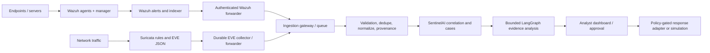

# SentinelAI Production-Oriented Implementation Plan

## Product boundary

Build SentinelAI as an analyst workflow and incident-case layer that integrates established defensive tools. Suricata remains the network IDS/IPS and source of network alerts. Wazuh remains the endpoint/SIEM manager for endpoint collection, decoding, rules, and alert generation. SentinelAI consumes their alerts, normalizes and correlates them into cases, enriches evidence, and assists analysts. It should not pretend to replace either product.

**Current workspace status:** prototype integrations exist, but this is not a production deployment. The Suricata shipper is a simple local tailer; the Wazuh route accepts Wazuh-shaped JSON but has no configured manager-side forwarder in this repository. The frontend login is mock-only, event APIs are unauthenticated, and response execution is disabled.

## Design decisions

1. **Keep source-of-truth data with the security tool where practical.** Wazuh's indexer/alert store retains Wazuh alert evidence and Suricata EVE retention follows the security operations policy. SentinelAI PostgreSQL stores case state, normalized references, approvals, generated analysis metadata and audit records. Avoid duplicating full packet/endpoint logs unless a documented query, retention or resilience requirement justifies it.
2. **Use PostgreSQL for production case data.** SQLite is for local development and demos only. Wazuh's own indexer is designed for security alert search and scale; do not turn one SQLite database into a SIEM data lake.
3. **Make existing sensors authoritative first.** Prefer Wazuh and Suricata detections, then add SentinelAI correlation and enrichment. Any custom rules or ML detector must be additive, separately labeled, evaluated and tuned to prevent duplicate/noisy alerts.
4. **Never let the LLM create or execute a response command.** The AI can summarize evidence and recommend a versioned playbook. Response adapters receive only schema-validated, policy-approved parameters after authorization and approval.
5. **Preserve provenance.** Every normalized event must retain source product, source alert/event ID, sensor/agent ID, timestamp, rule/signature ID, raw-evidence reference, ingest time and parser/schema version.

## Production integration flow

For a small deployment, a durable queue may be deferred if the collector has bounded local disk buffering, durable checkpoints, retries, backpressure and observable delivery failures. Add Kafka/Redpanda or another broker when measured volume/availability requirements need it, not as a checkbox.

## Phased delivery

### Phase 0 — Inventory and supported deployment profile

- Document exact supported versions, OSs, network interfaces, expected telemetry, deployment shape and data-flow diagram.
- Decide whether the supported integration is Wazuh Manager alert forwarding, Wazuh Indexer API querying, or both. Prefer the supported manager-side alert integration when the receiving platform is a third-party SIEM and infrastructure should remain lean; use indexer queries only when SentinelAI needs historical search and credentials/access can be isolated.
- Document Suricata version, EVE schema assumptions, rule source/update process, interfaces, `HOME_NET`, log rotation, and payload policy.
- Define expected ingest rates, burst size, event retention, RPO/RTO, deployment region and user roles with the intended operating organization.

### Phase 1 — Make native tools reliable

- Install and operate Wazuh manager/agents using Wazuh's supported deployment; enable JSON alerts and confirm agent health, rule version, manager health and indexer availability.
- Configure Suricata native EVE JSON to emit only necessary types. Minimize packet payload, printable payload, HTTP body, and sensitive endpoint fields by default. Manage rule updates and validate config before reload.
- Retire the custom raw-socket Windows IDS from the production architecture unless a specific sensor gap and validation justify maintaining it. It can remain a teaching/demo component, clearly labeled.
- Keep sensor/manager secrets and certificates outside the repository. Separate lab/test credentials from production identities.

### Phase 2 — Build production-grade forwarding

- Replace `suricata_shipper.py`'s non-durable tail loop with a supported collector or managed forwarder. Require checkpoints that survive restart, file rotation/truncation handling, bounded disk spool, retry/backoff, deduplication keys, dead-letter/failed-event visibility and a clear delivery acknowledgment.
- Add a Wazuh manager integration/forwarder that reads the supported JSON alert output or securely queries the indexer. Authenticate with a dedicated least-privilege identity; validate TLS certificates; use timeout, backoff, bounded queues and delivery metrics.
- Give every sensor/forwarder an identity. Authenticate ingress (mutual TLS or scoped short-lived credentials; signed requests where appropriate), rotate credentials, enforce network policy and reject replayed/oversized/malformed requests.
- Do not silently drop an alert when SentinelAI is down. Buffer within a configured storage limit, expose lag/drop counters, and page/alert the operator when capacity is exhausted.

### Phase 3 — Normalize, deduplicate and correlate

- Define a versioned canonical alert envelope, with adapters for Suricata EVE alert records and Wazuh alert JSON. Preserve the original source document/reference and parser version.
- Validate timestamps, IPs, IDs, signatures, severity, agent IDs and payload size. Separate event time from ingestion time and handle clock skew.
- Deduplicate by source-native alert ID where available; otherwise use a stable fingerprint and bounded time window. Make writes idempotent.
- Correlate on stable entities (asset/agent, account, IP, process, domain), time window and evidence links. Record why an alert joined a case. Do not group by title text.
- Retain source severity separately from normalized priority. Document mappings and do not rewrite source severity in place.
- Use MITRE ATT&CK mappings from source rules where available; represent inferred mappings with confidence and analyst review.

### Phase 4 — Secure case-management service

- Use PostgreSQL with Alembic migrations; add tenant/organization, asset, sensor, user, role, incident, evidence reference, case status history, approval, response execution and audit entities.
- Integrate an organization identity provider (OIDC/SAML), MFA, short-lived sessions and RBAC. Enforce tenant/object authorization on every route and websocket/query.
- Add immutable/append-only audit records, retention controls, data export/deletion procedures, backup/restore drills and permissioned evidence access.
- Remove demo credentials; bind local development services to loopback and use managed TLS/secret handling in deployed environments.

### Phase 5 — AI/RAG assistant after evidence controls

- Keep Suricata/Wazuh deterministic detections as the detection authority. AI does not decide whether a sensor alert is real or suppress a source alert.
- **Implemented prototype step:** a LangGraph chat workflow retrieves up to five recent incidents and linked alert/sensor metadata; without a Groq key it returns a deterministic digest, and with a key it requests a plain-language summary.
- Describe this as SQL-backed, evidence-grounded generation, not vector RAG. Qdrant is not required for recent-case lookup. Add it only for semantic search across approved runbooks/reports if an evaluated need exists.
- LangGraph retrieves only authorized case evidence, the relevant internal runbook and approved threat-intel context. It returns typed fields: observed facts, hypotheses, confidence, evidence references, suggested actions and limitations.
- Treat alert descriptions, logs and retrieved documents as untrusted data; defend against prompt injection and tenant leakage. Use strict tool allowlists and read-only data access.
- Keep vendor/model selection configurable and validate privacy/retention/training terms before sending any telemetry to an external model. Prefer minimal redacted evidence, not raw EVE/endpoint logs.
- Store model/provider, prompt, retrieval corpus, cost, latency, errors and analyst feedback. If AI is unavailable, show that honestly and keep sensor ingestion and cases functional.
- Evaluate factual grounding/citation coverage, hallucinations, false reassurance, analyst acceptance, latency and cost on a fixed sanitized corpus.
- The current application has a Groq provider path (`GROQ_API_KEY`, configurable `GROQ_MODEL`). `GEMINI_API_KEY` is not yet wired into the agent, and no Qdrant or MCP server is included. Do not create keys until choosing those integrations; never store keys in frontend code or commit them.
- A future MCP adapter may expose narrowly scoped read-only case/runbook tools to other clients, but only after authentication and authorization are enforced. It is not needed for the backend's own LangGraph-to-database retrieval.

### Phase 6 — Human-approved response integration

- Keep response execution disabled until identity, role authorization, approval records, action policy, target ownership/scope validation, audit, rollback/expiry, rate limits and kill switch are implemented.
- Begin with simulation-only playbooks; validate them in a disposable environment and ensure no real host changes occur.
- Later, integrate with an approved SOAR/EDR/firewall management API through a separate least-privilege response service. Never launch local elevated shell commands from the web/API process, and never derive action targets from free-text titles or LLM output.
- Require preview and explicit approval by an authorized analyst. Consider dual approval for high-impact actions. Record requester, approver, evidence, exact parameters, execution result and rollback status.

### Phase 7 — Operations and production gates

- Define and measure service-level indicators for event acceptance, event-to-case latency, source health, forwarder lag, dropped events, API availability, AI latency and response execution.
- Load test representative alert bursts; test Wazuh/Suricata restarts, queue outages, database outages, duplicate delivery, clock skew, provider failure and full spool.
- Add metrics, structured logs, traces, health checks, alert rules, operator dashboards and incident runbooks. Protect logs and redact secrets/PII.
- Pin dependencies, scan packages/images, generate SBOMs, use reviewed CI releases and signed immutable artifacts; separate environments and verify restore/rollback.
- Complete threat modeling and an independent security assessment before production telemetry or response credentials are connected.

## Required demo scenarios

1. A scoped lab network event is detected by Suricata, parsed with original SID/signature and event provenance, and appears as one SentinelAI case.
2. A controlled endpoint event is detected by Wazuh, forwarded from the manager/indexer path, and traced to the originating agent, rule and source alert ID.
3. Related Suricata and Wazuh evidence is correlated into one case with an explainable reason and deduplication behavior.
4. The AI generates an evidence-linked report; provider outage and prompt-injection test data do not stop ingestion or create unsupported facts.
5. A response playbook runs in simulation, records an approval/audit trail, and demonstrates that no host firewall change occurs.

## Current implementation gaps to track

- The existing Suricata shipper has no durable offset, starts at EOF, and drops failed HTTP posts; the runner launches a custom Windows capture config with hard-coded NIC GUIDs.
- Suricata configuration enables payload and printable-payload logging; `HOME_NET` is broad and config paths are machine-specific.
- The canonical Wazuh API route now maps native rule level, rule ID, agent identity and MITRE IDs into a SentinelAI event/alert/case. The repository still has no Wazuh server/agent deployment or configured manager-side forwarder; a synthetic POST is not live Wazuh integration.
- The duplicate Wazuh route has been removed; use `/api/v1/sensors/wazuh` as the canonical local adapter. Add authentication, versioning, replay protection and compatibility policy before production exposure.
- SQLite is the application default; Docker Compose starts only PostgreSQL with hard-coded demo credentials, and the API has no production authentication.
- Current custom rules, anomaly mock and incident correlator are not validated as enterprise detection. They must remain supplementary until evidence and evaluation establish value.
- The response API route now fails closed and the dashboard action is disabled; do not describe one-click firewall injection as implemented.

## Reference implementation guidance

- [Suricata EVE JSON output](https://docs.suricata.io/en/latest/output/eve/eve-json-output.html) documents EVE event output and rotation options.
- [Wazuh third-party integrations](https://documentation.wazuh.com/current/integrations-guide/index.html) documents reading `alerts.json` and forwarding through a data forwarder; the Wazuh documentation recommends server-side integration when a separate indexer deployment is not warranted.
- Wazuh's [JSON alert output](https://documentation.wazuh.com/current/user-manual/reference/ossec-conf/global.html) is enabled by default and is consumed by its own indexing pipeline; avoid disrupting that pipeline.

External product documentation should be checked against the exact deployed version before rollout.
